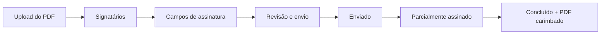

<div align="center">

# ✍️ SignFlow — Assinatura de Documentos no Android

**App Android nativo para preparar, enviar, assinar e acompanhar documentos PDF pelo celular.**
Desenvolvido individualmente para o **Challenge FIAP × LetsSign** (Sprint 1).


</div>

---

## 📌 Sobre o projeto

O SignFlow resolve o fluxo completo de assinatura eletrônica no celular: o **administrador** sobe um PDF, escolhe os signatários (contratante, contratado, testemunha), posiciona os campos de assinatura e envia; cada **signatário** recebe o documento, assina à mão na tela e o status é atualizado automaticamente até a conclusão.

### ✨ Destaques técnicos

- 🧱 **MVVM + Repository** com camada de domínio sem dependência de Android, pronta para trocar Room por uma API REST na Sprint 2
- 🖊️ **Editor de campos** sobre o PDF renderizado: adicionar, arrastar, redimensionar e excluir, com posição salva **relativa à página** (igual em qualquer tela)
- 📄 **PDF final carimbado** com PDFBox-Android: assinaturas na posição dos campos + página de autenticidade com protocolo, **hash SHA-256** e trilha de eventos
- 🔒 Senhas com **PBKDF2 + salt**, isolamento de dados por usuário e termo de aceite antes de assinar
- 🛡️ Validação de PDFs inválidos, corrompidos, protegidos por senha ou maiores que 20 MB
- 🔁 Reenvio **sem duplicar** solicitações (protocolo UUID + índice único) — com modo de simulação de falha de rede
- 🧪 Testes unitários das regras de negócio (`DocumentoRulesTest`)

### 🔄 Fluxo do documento



---

## Como executar

1. Abra a pasta do projeto no **Android Studio** (Ladybug ou mais recente).
2. Aguarde o *Gradle Sync* terminar (a primeira vez baixa as dependências).
3. Conecte um celular Android 8.0+ (ou crie um emulador) e clique em **Run ▶**.

### Gerar o APK

- Menu **Build › Build App Bundle(s) / APK(s) › Build APK(s)**
- O arquivo fica em `app/build/outputs/apk/debug/app-debug.apk`

Pelo terminal: `./gradlew assembleDebug` (Windows: `gradlew.bat assembleDebug`).

### Usuários de demonstração (criados na primeira execução)

| Perfil | E-mail | Senha |
|---|---|---|
| Admin | admin@letssign.com | admin123 |
| Signatária | ana@email.com | 123456 |
| Signatário | bruno@email.com | 123456 |
| Signatária | carla@email.com | 123456 |

A tela de login tem atalhos para preencher Admin e Ana.

---

## Funcionalidades (requisitos do enunciado)

| # | Requisito | Onde está |
|---|---|---|
| 1 | Login com perfis Admin e Signatário | `ui/login` — senha com hash PBKDF2 + salt |
| 1 | Admin vê enviados, parcialmente assinados e concluídos | `ui/admin` — painel com contadores e filtros |
| 1 | Signatário vê pendentes e assinados | `ui/signatario` — abas Pendentes / Assinados |
| 2 | Cadastro e edição de signatários (nome, e-mail, telefone, senha) | `ui/signatarios` — validação de todos os campos e e-mail único |
| 3 | Fluxo de documento em 7 passos | `ui/novo` — assistente em 4 etapas (título + PDF, signatários, campos, revisão) |
| 3 | Aviso de arquivo inválido, corrompido ou não processável | `PdfStorage.validar` — cabeçalho `%PDF-`, PDF com senha, sem páginas, falha ao renderizar, > 20 MB |
| 3 | Classificar como contratante, contratado ou testemunha; remover e **substituir** | Etapa "Signatários" |
| 4 | Adicionar, arrastar, mover, excluir e redimensionar campos; vários por signatário | Etapa "Campos" |
| 4 | Posição salva **relativa à página** (0..1) | `CampoAssinaturaEntity` — igual em qualquer tela |
| 5 | Revisão: documento final, signatários, campos/páginas, mensagem do convite | Etapa "Revisão" |
| 5 | Nova tentativa **sem duplicar** solicitações | Protocolo (UUID) por rascunho + índice único no banco |
| 6 | Situação geral e individual, datas, histórico, documento final | `ui/detalhe` |
| 7 | Assinar e atualizar status | `ui/assinar` — assinatura desenhada à mão |

### Regras de negócio

- Mínimo de 1 signatário; todo campo associado a um participante; todo signatário com pelo menos um campo.
- Campos sempre dentro dos limites da página (`DocumentoRules.limitar`).
- O documento enviado é **imutável**: "Criar nova versão" gera v2, v3… com um novo fluxo, e a versão anterior fica preservada.
- O status do documento é **calculado** a partir das assinaturas: Enviado → Parcialmente assinado → Concluído (só quando todos assinam). O registro de cada signatário passa de Pendente para Assinado.
- Isolamento: um admin só vê os próprios documentos e signatários; o signatário só vê documentos enviados para ele (`podeAcessar`).

### Diferenciais

- **PDF final carimbado** com PDFBox-Android: cada assinatura é desenhada na posição do campo, com nome e data, e é adicionada uma **página de autenticidade** com protocolo, hash SHA-256 do original e trilha de eventos.
- **Hash SHA-256** do arquivo original registrado no envio, para prova de integridade.
- **Compartilhamento** do PDF assinado via FileProvider, sem expor os arquivos do app.
- **Modo demonstração de falha de rede** na revisão, para mostrar a nova tentativa sem duplicar.
- Termo de aceite antes de assinar e evento de "documento visualizado" no histórico.

---

## Arquitetura

MVVM + Repository, com injeção de dependências manual (`AppContainer`).

```
app/src/main/java/br/com/fiap/signflow
├── domain/            regras e contratos, sem dependência de Android
│   ├── model/         Usuario, DocumentoDetalhe, CampoAssinatura, enums
│   ├── repository/    interfaces AuthRepository, SignatarioRepository, DocumentoRepository
│   └── rules/         DocumentoRules (validação e cálculo de status — com testes)
├── data/
│   ├── local/         Room: entidades, DAOs, AppDatabase, mappers
│   ├── files/         PdfStorage (arquivos), PdfPageRenderer (PdfRenderer), PdfStamper (PDFBox)
│   └── repository/    implementações Room* das interfaces
├── core/              AppContainer, SessionManager, PasswordHasher, Formatters
└── ui/                telas Jetpack Compose + ViewModels, navegação e tema
```

### Persistência

- **Room** para usuários, documentos, signatários do documento, campos e eventos.
- **PDFs no sistema de arquivos interno** (`filesDir/pdfs`). O banco guarda nome, caminho, datas, status e hash (opção 1 do enunciado).
- Os repositórios são **interfaces**. Na Sprint 2, basta criar implementações que chamam a API REST (Spring Boot + MongoDB) e trocá-las no `AppContainer`, sem mexer nas telas.

### Tecnologias

Kotlin 2.1 · Jetpack Compose (Material 3) · Navigation Compose · Room 2.7 (KSP) · Coroutines/Flow · PdfRenderer (Android) · PDFBox-Android 2.0.27 · JUnit.

### Testes

`app/src/test/.../DocumentoRulesTest.kt` cobre cálculo de status, limites dos campos e validação de envio.
Para rodar: `./gradlew test`.

---

## 👤 Autor

**Christian Santos** — Estudante de Análise e Desenvolvimento de Sistemas na FIAP · Desenvolvedor Back-end & Mobile

[](https://www.linkedin.com/in/christian-santos-6530bb247/)
[](https://christiangit2025-sys.github.io)
